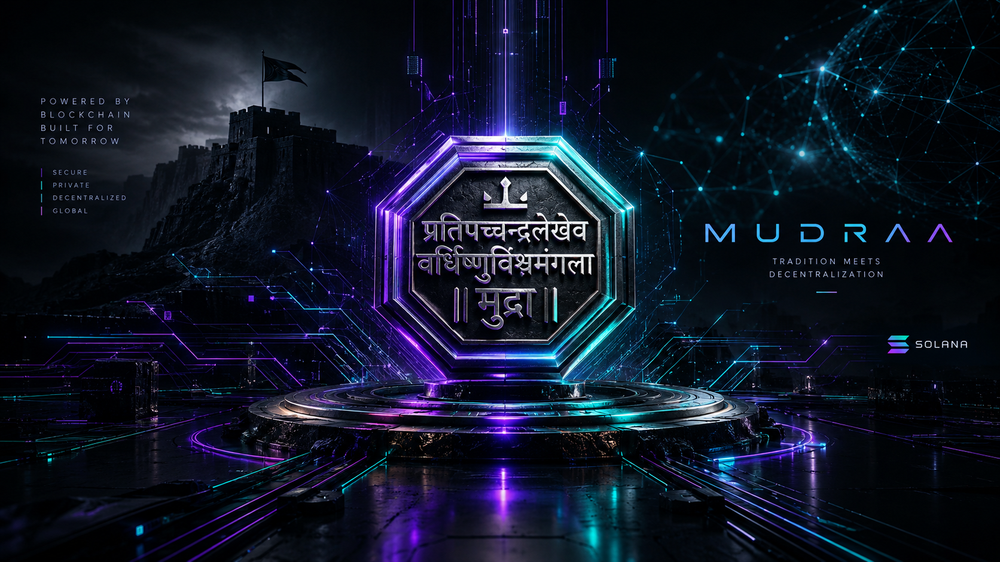

<div align="center">

# MudrAA
### Powered by the Rajmudra Verification Engine

**Institutional-grade sovereign trade liquidity on Solana.**  
*Delivering deterministic settlement finality, bilateral freight provenance, and shielded enterprise credit.*

<br />



<br />

[](https://github.com/GamersStop/MudrAA)
[](https://mudr-aa.vercel.app/)
[](https://solana.com)
[](https://coral-xyz.github.io/anchor/)
[](https://spl.solana.com/token-2022)
[](https://en.wikipedia.org/wiki/Zero-knowledge_proof)
[](https://fastapi.tiangolo.com)
[](https://nextjs.org)
[](LICENSE)

</div>

---

## ⚔️ The Vision & Sovereign Heritage

Global cross-border trade finance is a **$3.5 Trillion** economic engine that remains constrained by legacy verification rails, slow settlement velocity, and systemic collateral friction. Exporters face 60-to-90-day liquidity constraints, while institutional credit allocators struggle with counterparty verification, opaque fulfillment tracking, and unhedged balance sheet risks.

Existing Web3 RWA protocols attempted to bridge real-world trade assets on-chain—but forced enterprises into a fatal dilemma: **sacrifice commercial pricing, volumes, and counterparty relationships on a public ledger, or rely on an opaque, centralized intermediary.**

**MudrAA** bridges this divide.

Originating from Maharashtra, the protocol derives its administrative governance and defensive architecture from the **Ashta Pradhan** (the Council of Eight Ministers) instituted by **Chhatrapati Shivaji Maharaj**. At its core lies the **Rajmudra Verification Engine**—a modern cryptographic realization of the historic royal seal that guaranteed authentic state records, tamper-proof execution, and public trust for sovereign welfare.

---

## 🏛️ The Ashta Pradhan Architecture

MudrAA coordinates its execution, security, and capital lifecycle across eight specialized institutional pillars:

| Pillar | Historical Role | Protocol Function & Implementation |
|---|---|---|
| **Peshawa** | Executive Dispatcher | High-throughput Anchor instruction orchestration, protocol initialization, and operational governance. |
| **Amatya** | Treasury & Accounts | Multi-tranche capital underwriting (Senior 6% APY & Junior 18% APY), waterfall fee distributions, and USD reserve management. |
| **Sachiv** | Sovereign Seal | The **Rajmudra Engine**—on-chain Groth16 zero-knowledge proof verification on Solana L1 (BN254 curve pairing). |
| **Sumant** | External Gateway | Ingestion of Peppol BIS 3.0 e-invoicing XML, Carrier AIS IoT vessel telemetry, GST/Tax validation, and Pyth oracles. |
| **Senapati** | Citadel Commander | Anti-double-pledging registry, deterministic nullifier PDAs, and instant emergency circuit breaker pause. |
| **Nyayadhish** | Chief Justice | Cross-border legal escrow anchoring, UNCITRAL arbitration perfection, and bill-of-lading claim covenants. |
| **Panditrao** | Compliance & Ethics | Token-2022 Transfer Hook KYB registry enforcing accredited institutional access without open-ledger surveillance. |
| **Waknavis** | Shielded Intelligence | Zero-knowledge Poseidon invoice commitments protecting supplier commercial secrets and unit pricing. |

---

## 🎬 Product Demonstration & Presentation

<div align="center">
  <a href="https://www.youtube.com/watch?v=VL-e-i2593Q" target="_blank" rel="noopener noreferrer">
    
  </a>
  <br />
  <p>
    <a href="https://www.youtube.com/watch?v=VL-e-i2593Q">
      <b>▶️ Watch the Full MudrAA Demonstration on YouTube</b>
    </a>
  </p>
</div>

---

## 🚀 Key Innovations Built on Solana

1. **High-Throughput Factor Advance Engine on Solana L1**:
   - Sub-second settlement finality for exporter invoice advances up to 80% LTV.
   - Deterministic programmatic accounting with zero intermediate escrow fees.

2. **On-Chain Groth16 Zero-Knowledge Verification (`invoice_verifier.circom`)**:
   - Verifies invoice existence and Carrier AIS coordinates without exposing confidential trade margins or buyer tax IDs.
   - Native BN254 alt_bn128 curve verification executed directly via Solana instruction.

3. **Deterministic Nullifier Registry (Anti-Double-Financing)**:
   - Systemic trade fraud occurs when the same bill-of-lading is financed across multiple banks.
   - MudrAA computes unique Poseidon nullifier PDAs: once committed to Solana consensus, duplicate pledging attempts are rejected atomically at the protocol level.

4. **SPL Token-2022 Transfer Hook KYB Enforcement**:
   - Secondary debt note transfers (`Token-2022`) are restricted via on-chain transfer hooks ensuring only Panditrao-whitelisted institutional wallets can hold trade assets.

5. **Multi-Tranche Capital Protection (Senior / Junior)**:
   - **Senior Tranche (6% Target APY)**: Protected by first-loss subordination and physical cargo claims.
   - **Junior Tranche (18% Target APY)**: Underwrites first-loss risk, receiving enhanced factoring protocol fee distributions.

---

## 🧭 Judge Evaluation Quickstart Guide

MudrAA includes a built-in **Multi-Wallet Evaluation Architecture** with three pre-funded Solana Devnet accounts for instant, zero-friction testing of live on-chain debit and credit settlements.

### The 3 Dedicated Devnet Counterparty Wallets

| Persona / Entity | Solana Devnet Address | Balance | Role in Settlement Flow |
|---|---|---|---|
| **Factory & Exporter** | `4215yZFmakPLePKXqYVqcBmVJHMK6SLfmJGW8h3UgQfG` | **~3.00 SOL** | **Credit (Beneficiary)**: Registers Peppol invoices & receives cash advances. |
| **Institutional LP (Lender)** | `C3CBRnk4xg9up53McWMNSYFMAYrUctGm2eWdvM4gipvP` | **~5.00 SOL** | **Debit (Payer)**: Deploys liquidity into pools & funds factoring advances. |
| **Admin Citadel & Approver** | `AzHZTAXadh8vBmT9SUQrqq1bKsMUjQaXacArWZZnyiJ8` | **~12.02 SOL** | **Protocol Custody**: Sovereign governor, emergency circuit breakers & ZK verifier. |

### Live Debit & Credit Verification Runbook

1. **Option A: Test Factory / Exporter Factoring (Cash Advance Drawdown)**:
   - Launch the portal at [https://mudr-aa.vercel.app/](https://mudr-aa.vercel.app/) (or local [http://localhost:3000](http://localhost:3000)).
   - Click **"Connect Wallet"** &rarr; Select **"Factory & Exporter Wallet"** (`4215yZFm...`).
   - Click **"Register Invoice"** (auto-fills canonical Peppol BIS 3.0 data or drop XML).
   - Click **"Generate Rajmudra Proof & Submit"**.
   - Observe client-side Groth16 witness generation and confirmation on Solana Devnet.
   - Click **"View on Solana Explorer ↗"**: Inspect the on-chain transfer where **LP (`C3CBRnk4...`) is debited** and **Exporter (`4215yZFm...`) is credited**.

2. **Option B: Test Institutional LP Capital Allocation (Underwriting Vaults)**:
   - Click the wallet menu &rarr; **"Sign Out"** &rarr; Select **"Institutional LP Wallet"** (`C3CBRnk4...`).
   - Navigate to **"Liquidity Desk"** or **"Amatya Vaults"** (`/vaults`).
   - Enter `5,000 USDC` &rarr; Select Senior or Junior Tranche &rarr; Click **"Authorize & Allocate Capital"**.
   - Watch the live transaction confirm on Devnet; Senior/Junior Pool TVL increments immediately.

3. **Option C: Real Personal Wallet (Phantom / Solflare / Backpack)**:
   - Connect your personal Solana wallet set to **Solana Devnet**.
   - Test full non-custodial invoice submission and liquidity underwriting with your own keys.

---

## 🛠️ Repository Architecture

```text
MudrAA/
├── backend/
│   ├── circuits/                     # Groth16 Circom zero-knowledge verification circuits
│   │   ├── invoice_verifier.circom
│   │   └── build_circuit.sh
│   ├── programs/mudraa_core/         # Anchor 0.30.1 Solana Program
│   │   ├── src/
│   │   │   ├── lib.rs                # Program entrypoint & 8 Ashta Pradhan instructions
│   │   │   ├── instructions/         # Factoring, ZK verifier, Transfer Hook, Nullifiers
│   │   │   └── state/                # InvoiceRecord, Nullifier, SyndicateVault PDAs
│   │   └── tests/                    # Security test suites (Double-pledge, Front-running, KYB)
│   └── offchain_service/             # FastAPI Ingestion & ZK Relayer Service
│       ├── api/v1/                   # Invoices, Legal escrow, Compliance, Oracles
│       ├── core/                     # Peppol BIS 3.0 parsing, Carrier/Tax/Pyth oracles, Security
│       │   └── security.py           # Rate limiting & CSRF protection middlewares
│       └── tests/                    # 22/22 unit & integration tests
├── frontend/                         # Next.js 15 Institutional Portal
│   ├── src/app/                      # App router desks (Dashboard, Exporter, Liquidity, Vaults, Admin)
│   │   ├── terms/                    # Institutional Terms of Service
│   │   └── privacy/                  # Zero-Knowledge Privacy & Cookie Policy
│   ├── src/components/               # UI components, Telemetry bars, Role guards, Consent banners
│   └── src/context/WalletContext.tsx # Non-custodial wallet & evaluation session manager
├── docker-compose.yml                # 1-Command reproducible container stack
├── Anchor.toml                       # Anchor configuration & Devnet deployment profile
└── README.md                         # Protocol documentation & Judge guide
```

---

## 🧪 Testing & Reproducibility Runbook

### 1. Backend & Oracle Tests (FastAPI + PyTest)
```bash
cd backend/offchain_service
python -m pytest
```
> **Result**: `22 passed in ~3s` covering Peppol BIS parsing, XXE defenses, Carrier AIS GPS telemetry, Pyth FX pricing, and Groth16 proof formatting.

### 2. Frontend Build & Static Typecheck (Next.js 15)
```bash
cd frontend
npm run build
```
> **Result**: Zero lint/type errors. All 16 routes compiled with strict Content-Security-Policy and sub-resource integrity headers.

### 3. Solana Anchor Program Tests
```bash
anchor test
```
> Executes automated test scenarios including:
> - `security_double_pledge.ts`: Verifies atomic rejection of duplicate nullifiers.
> - `security_kyb_bypass.ts`: Verifies non-whitelisted wallets are rejected by Token-2022 transfer hooks.
> - `security_proof_malleability.ts`: Verifies altered Groth16 inputs fail cryptographic pairing.

---

## 🐳 One-Command Docker Setup

To launch the entire stack (PostgreSQL, Redis, FastAPI Offchain Relayer, and Next.js Frontend) in unified containers:

```bash
docker-compose up -d
```

- **Frontend Portal**: [http://localhost:3000](http://localhost:3000)
- **Offchain Relayer API**: [http://localhost:8000/docs](http://localhost:8000/docs)
- **Health Telemetry**: [http://localhost:8000/health](http://localhost:8000/health)

---

## 🛡️ Security, Privacy & Legal Architecture

- **Zero Ambient Cookie Reliance**: Non-custodial Ed25519 wallet signatures required for all state transitions.
- **CSRF & Rate Limiting**: Token-bucket sliding window (120 req/min) and Origin validation in [`core/security.py`](backend/offchain_service/core/security.py).
- **XML External Entity (XXE) Protection**: Strict `defusedxml` enforcement for Peppol electronic invoice parsing.
- **Transparent Local Storage Policy**: Complete disclosure and consent banner pursuant to EU GDPR, UK DPA, and Indian DPDP Act 2023.
- **Sovereign Legal Rails**: Institutional Terms of Service ([`/terms`](frontend/src/app/terms/page.tsx)) and Privacy & Cookie Policy ([`/privacy`](frontend/src/app/privacy/page.tsx)).

---

## 📜 License

Licensed under the [Apache License, Version 2.0](LICENSE).
© 2026 MudrAA Protocol Foundation. All rights reserved.